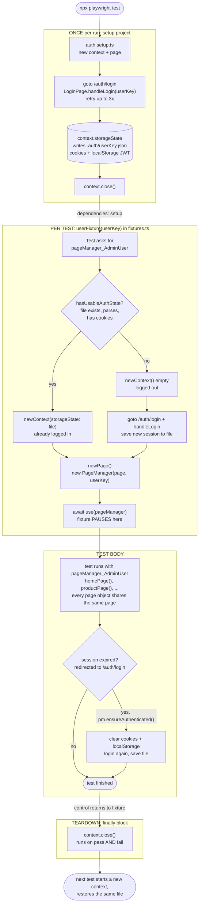
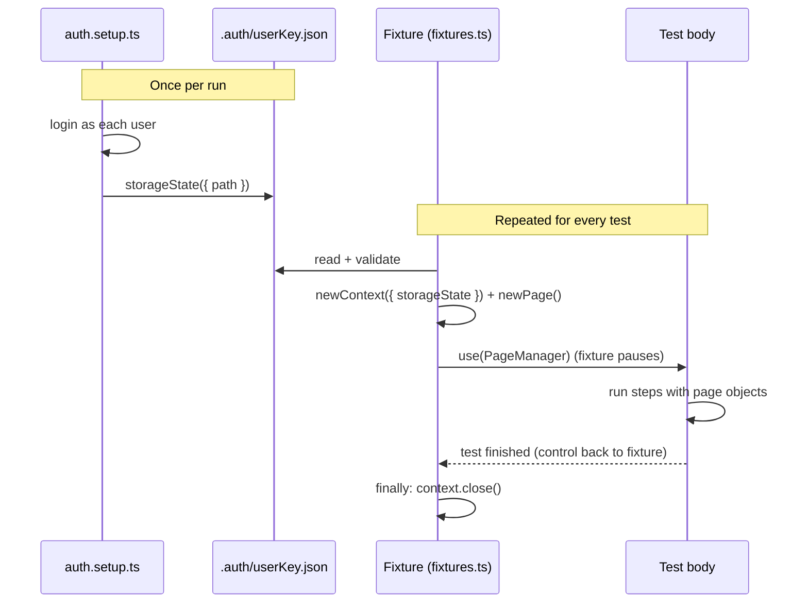
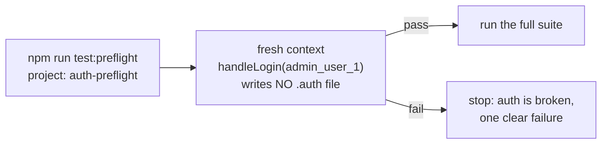

# Auth State Mechanism

Log in once per run, save the session to a file, and let every test restore it instead of logging in again.

| File | Role |
|---|---|
| [Users.ts](../Users.ts) | `getUser(userKey).path` gives `.auth/<userKey>.json` |
| [tests/auth.setup.ts](../tests/auth.setup.ts) | Logs in every user, saves their session (runs once) |
| [fixtures.ts](../fixtures.ts) | Per test: restore the session into a context, hand a `PageManager` to the test |
| [helpers/pageManager.ts](../helpers/pageManager.ts) | Holds the test's `page`, builds page objects, `ensureAuthenticated()` |
| [tests/preflight/authCheck.spec.ts](../tests/preflight/authCheck.spec.ts) | Optional gate: can anyone log in at all? |

## 1. Whole flow

## 2. Order of events (sequence view)

## 3. Who writes the file

| Writer | When |
|---|---|
| `auth.setup.ts` | Every run, for every user in `SETUP_CASES` |
| Fixture fallback | Only when the file is missing or unusable, then saves the fresh login |
| `pm.ensureAuthenticated()` | Only when a session expires mid-test |

The fixture teardown does **not** write the file. It only closes the context.

## 4. Key points

- **A context is an isolated browser profile; a page is a tab in it.** Every new context starts empty, so the saved file is the only way to carry the login into a test.
- **`storageState` restores cookies and localStorage only.** The page still starts at `about:blank`, so each test navigates itself (`homePage.navigateToHome()`).
- **The fixture is test-scoped.** The restore, `use`, `close` cycle runs per test, not once after all specs.
- **`use(pm)` is not a return.** It hands the value to the test and pauses the fixture, so the code after it runs as teardown.
- **One page per test.** `PageManager` passes the same `page` to every page object and fragment.
- **`.auth/` is gitignored**, so sessions never reach git.

## 5. Preflight (separate gate, run before the suite)

